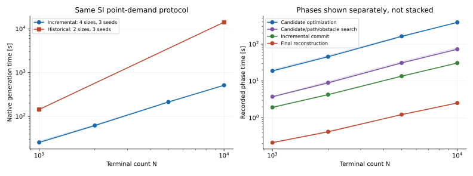
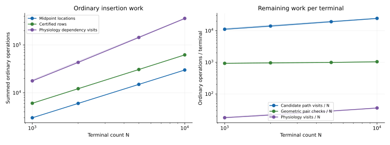
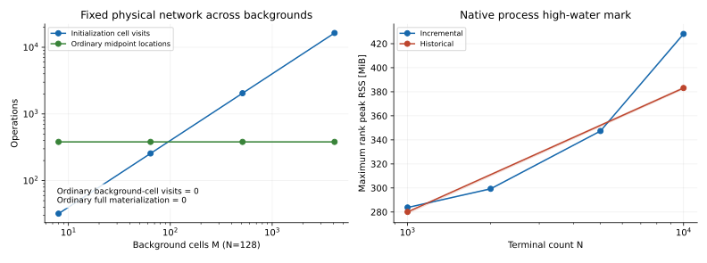

# Incremental vascular growth: execution and measured cost

The measurements in this report use the pinned SI point-demand source of
PR #312, before the mesh and integrated-demand changes of PR #311.
An ordinary insertion updates persistent native state and checks the affected
geometry. The final public network materializes physical radii, native ownership
and ghosts, then passes an independent full reconstruction.

The subsequent mesh/demand PR #311 supplies different physical geometry measures
and integrated tissue-demand callbacks to the same private execution backend.
Its timings describe a different physical problem and are reported separately.
No public legacy switch or alternate approximate generator is used here.

The initial A–K audit preceded implementation on base #310 at
`4bcc361dbd19f770247a343c379285705f0f6738`; remote master was fetched and
inspected at `3660ddc27ffdf0c942bfe0038d2080feb45481dc`.
The initial source inventory and instrumentation remain in commit `be17bde`.

## Cost inventory

`N` denotes physical entities, `M` background cells, `L` numerical line cells,
`D` ancestral depth, `B` attempted batches and `P` MPI ranks. `A` counts the
changed dependencies that are actually visited; `K` counts returned geometric
records, including conservative broad-phase hits. Candidate and optimizer
limits are explicit controls, not constants when users vary them.

| Audit | Previous repeated work | Current treatment | Remaining cost |
|---|---|---|---|
| A | Copy and validate every local node, vessel and terminal at each commit | Retain native rows; keep before-images only for edited records; preliminary selection projects only proposed old vessels, endpoints and declared ports | Initial/final full validation; K record copies/validation per proposal |
| B | Rerun full physical migration and ghost rebuilding | Locate only new junction/tip coordinates and edited/new midpoints; preserve old endpoint authorities; update native rows and endpoint-node ghosts | Final public native redistribution materializes vessel ghosts once |
| C | Recheck every vessel after each normalization | Certified envelopes remain valid while their proofs cover current radius and clearance; check new geometry and actual enlargement/shrink events | Changed geometry, expired envelope events and returned pair hits; full independent certification once at output |
| D | Rebuild complete centerline indices | Native R-trees retain owned and mutable centerlines; only edited or migrated entries are removed/inserted | Logarithmic index edits; temporary candidate trees contain returned/local trial records |
| E | Rebuild background routing/search and boundary data | One background context spans startup, A/V growth and calibration attempts; native point location reuses its routing and strict physical-coordinate checks | Mapping prechecks still scan M per independent calibration attempt, outside ordinary batches |
| F | Recompute the complete Murray/flow/objective forest | Exact positive demand mass, a persistent terminal directory and affected ancestor unions update branch summaries; root/system normalization stays lazy | Actual affected paths, including distant territories and changed roots; root-prefix directories use at most 65 levels |
| G | Build complete trial snapshots and fetch the graph for candidate evaluation | Sparse candidate paths and physical obstacle replies use one globally ordered demand overlay; ancestor certificates and a trial R-tree avoid the old unconditional D-by-D pair loop | Candidate/optimizer work on D records; conservative geometric hits remain visible |
| H | Restart venous nearest searches and transmit all rejected IDs; advance through pending maps | Retain native nearest cursors and authority-local availability; ranked pending selection preserves the sorted-ID ordinal | Real returned nearest records, claims and active cursor memory |
| I | Scan all candidate cells for every crossing; rescan all intervals for every cut; shift cut vectors | Native cell queries, sorted overlap events, a monotone metric cursor, binary-search/bounded profile reads and stable list edits | Sorting plus actual overlapping records; long-segment counters cover 8/32/128/512 crossed cells |
| J | Rebuild identity/owner and global control state | Persistent sharded directories, cached root bounds/minimum leaf demand and a one-time ID maximum followed by fixed strides | Small collective control exchanges and remote path rounds remain; the producer protocol is not identical-work MPI scaling |
| K | Mix one-time output and solver work with insertion cost | Separate initialization and finalization counters/times from batch totals; share immutable geometry through retries | Final coverage, line mesh, full reconstruction, Poiseuille solve, tables and independent calibration attempts |

## Acceptance, invalidation and rollback

`GrowthExecution` owns native rows, demand summaries, indices and certificates.
Its accepted view borrows this state in constant time; it does not copy or
materialize a `NetworkData`. Ordinary consumers query physical candidate values
through the demand state. A new borrowed view is required after staging, even
if the physical revision remains unchanged after rejection.

Demand changes are absolute new values keyed by stable terminal ID. The native
terminal owner may move; a persistent directory resolves delivery. The new leaf
and the joint old-terminal changes are adopted together. Independent territory
previews cannot be added to form a batch: the selected set receives a fresh
joint preview and one journal.

Demand is summed exactly in integer multiples of `2^-1074`. Radius fractions,
length moments, resistance bounds and minimum-radius checks are derived from
these positive sums. The scaled radius minimum covers every generated branch,
including internal branches crossing a coarser cell, rather than only leaves.
A global flow-normalization change also checks the smallest unchanged leaf.
There is no demand floor or hidden demand rescaling.

Geometry certificates depend on endpoint geometry, radius bound, clearance and
ports. A valid unchanged certificate can cover a smaller physical radius, but
minimum radius and representability still require their own aggregate checks.
A demand transfer between roots can increase radii far from the inserted leaf;
that nonlocal work is retained and counted. Real envelope tightening events are
separate from ancestor demand changes, so a harmless update does not repeatedly
expand and rebuild the same certificate.

All preparation and logical validation precede the collective adoption vote.
Map/set node handles retain original rows and summaries for rollback, including
original addresses in the tested row journals. Geometry/profile releases use
edited keys. A rejection restores native rows, demand/topology, directories,
indices and certificates; tissue callbacks participate in the same decision.
The small tests compare each adopted or rejected step with immutable full
physics and native redistribution. General recovery from exhausted memory is
not a separate supported distributed execution mode.

Background, mapping and controls remain fixed during one execution. A new
public generation call constructs a new context. Calibration retains immutable
background caches while resetting mutable growth state for each attempt.

## Independent correctness checks

Small serial and MPI2/MPI4 tests compare the sparse path with immutable full
`evaluate_forest()`, complete native redistribution and exhaustive geometric
queries. They exercise distant old-terminal reweighting, multiple roots,
internal mesh-scale minima, tiny positive demand and tiny flow, both signs of
radius change, concurrent adjacent splits, native authority changes and empty
ranks. Native migration tests include separate 64-bit node/vessel/terminal
namespaces and 0/64 unrelated vessels.

Injected failures cover stale revisions, invalid demand, ownership preparation,
physiology, geometry and callback stages. Rejection restores the prior
revision, map values and original row/summary addresses, and retry succeeds.
Wall tests retain strict physical-coordinate checks for thin exterior offsets,
planar/two-sided ports, nonconvex gaps and warped faces. Obstacle overlays are
compared with exhaustive full physical trials, including other roots and frozen
input. The full reconstruction remains independent and is not replaced by an
incremental engine calling itself as its own oracle.

The interval rewrite preserves 32 old/new subdivision results byte-for-byte
and adds analytical work tests at 8/32/128/512 crossed cells. The actual public
application supplies the performance data; independent table readers check its
physical output and final numerical line intervals.

## Measurements and protocol

The native application, executable/library/profile hashes, source commit,
parameters, runners, physical tables and MPI ledgers are frozen per experiment.
Independent Python table checks validate topology, Murray radii, Poiseuille
resistance/pressure drop, target flows and complete numerical intervals. They
do not generate or modify a network.

The point-demand protocol matches the verified historical runs: unit cube,
M = 512, seed position (.2,.5,.5), direction +x, seed length .15, radius .003,
viscosity .004, total flow 2e-9, gamma 3, density exponent 0, no
length/radius/clearance lower bound, 12 candidate branches, 10 optimizer steps
and unchanged geometry and sampling budgets. Seeds 23/24/25 are retained.

The new application and libraries are frozen at `5ed0570`; the later
`b9a10db` change only includes an explicit Boost equality header for portability.
The later `6f7c027` correction ignores unassigned imported territory sentinels
and rejects exhausted identifier namespaces before arithmetic can wrap. The
frozen large-run inputs contain neither condition; that startup correctness
fix is not presented as a retimed performance campaign.
The historical source is `76bb381187285e57bdc281a09f2bdd4c09a70703`.
It differs from PR #310 in one venous line and no relevant arterial execution
source. The original manifests and executable/library hashes were verified;
the historical hours-long campaigns were not repeated.

| Terminals | New median [s] | New seed range [s] | Historical median [s] | New peak RSS, median [MiB] |
|---:|---:|---:|---:|---:|
| 1,000 | 25.473 | 24.743–27.537 | 144.296 | 283.75 |
| 2,000 | 61.942 | 60.133–64.662 | — | 299.29 |
| 5,000 | 213.115 | 210.749–220.212 | — | 347.35 |
| 10,000 | 514.571 | 506.175–514.873 | 14,177.369 | 428.09 |

The 10-fold terminal increase gives a 20.20-fold new time increase, compared
with 98.25-fold historically. The endpoint speedups are 5.66 and 27.55.
These four sizes are measurements, not a fitted asymptotic complexity claim.
At 10,000 terminals peak RSS exceeds the historical median of about 383 MiB;
the persistent state trades memory for less repeated reconstruction.

Ordinary counts below exclude initialization and finalization and include failed
attempts. Values are medians over the same three seeds.

| Terminals | Copies / midpoint locations | Certified rows | Physiology visits | Candidate path visits | Pair checks |
|---:|---:|---:|---:|---:|---:|
| 1,000 | 2,997 | 6,042 | 17,772 | 11,123,257 | 929,880 |
| 2,000 | 5,997 | 12,194 | 43,286 | 28,067,948 | 1,927,573 |
| 5,000 | 14,997 | 30,730 | 144,152 | 96,462,250 | 4,964,623 |
| 10,000 | 29,997 | 62,185 | 360,789 | 245,689,769 | 10,471,737 |

Ordinary background-cache constructions, background-cell visits and complete
materialized-vessel counts are zero in all twelve runs. Candidate path work
grows faster than N: median mean leaf depth grows from 20.33 to 44.32 and
maximum depth from 40 to 90. At 1,000 terminals candidate optimization takes
18.86 s, search 3.76 s, commit 1.93 s and final reconstruction 0.21 s.
Optimization remains the dominant cost; it was not uniformly accelerated.

For all three 1,000-terminal seeds, final terminal coordinates, demands and raw
sample counts match the historical cases. Seeds 23 and 25 also match complete
physical node/vessel geometry and radii. Seed 24 has different topology and
0.024% more total vascular volume; it is not described as bitwise equivalent.
All runs pass the same independent physics checks.

The [individual CSV](../_static/vascular-incremental-growth/measurements.csv),
[aggregate statistics](../_static/vascular-incremental-growth/summary.json) and
[SHA256 provenance](../_static/vascular-incremental-growth/manifest.json) are
distributed with these figures. `measurements.csv` retains individual seeds, depths,
operation counts, phase times, communication and native memory statistics.
Frozen campaign directories also retain input parameters, executable/libraries,
runners, host/affinity/environment, physical tables and per-rank MPI ledgers.
The [reproduction notes](../_static/vascular-incremental-growth/README.txt) name
those worker archives and the archived figure-rendering command.

The original instrumented structural baseline has midpoint counts
2,048/8,192/32,768 and certification counts 1,024/4,096/16,384 for
N = 32/64/128: exactly `2*N*N` and `N*N`, respectively. Those original counts
include initial normalization; the new table below excludes initialization and
finalization. The source rebuilt
all rows twice and certified all mutable vessels at each accepted insertion.
There were no rejected joint commits in those three cases.
The new small structural pilot shows:

| N | Ordinary copies | Vessel midpoint localizations | Certified rows, median | Physiology branch visits, median |
|---|---:|---:|---:|---:|
| 32 | 93 | 93 | 187 | 233 |
| 64 | 189 | 189 | 380 | 554 |
| 128 | 381 | 381 | 765 | 1334 |

Ordinary background-cache construction, background-cell visits and complete
materialization are zero in every pilot. At fixed N = 128, varying M through
8/64/512/4096 gives initialization cell visits exactly `4*M` and zero ordinary cell
visits. Physical node, vessel, terminal and territory tables are identical per
seed across all four backgrounds. MPI2/4 pilots preserve independent physical
checks; their topology, proposed work and batches can differ from serial.

MPI runs use the same controls but can propose and accept different batches.
N = 128 is tested with all three seeds on two and four ranks. The two larger
MPI cases use seed 23 only; they are representative checks, not scaling fits.
Communication below sums rank-local records from the three growth phases.
Logical bytes combine posted send payload and collective input bytes, not
wire traffic. Reductions include size-one calls.

| N | Ranks | Generation [s] | Posted sends | Logical bytes | Reductions |
|---:|---:|---:|---:|---:|---:|
| 1,000 | 1 | 25.473 (3-seed median) | 0 | 3,082,221 | 319,301 |
| 1,000 | 2 | 26.917 (seed 23) | 121,237 | 42,030,937 | 516,100 |
| 1,000 | 4 | 25.964 (seed 23) | 240,078 | 72,481,079 | 765,072 |
| 10,000 | 1 | 514.571 (3-seed median) | 0 | 39,500,511 | 5,380,199 |

P2/P4 ordinary midpoint counts are 3,231/2,997, copies 3,240/3,030 and
physiology visits 17,795/14,443. Rejected attempts and different producer
schedules explain why counts need not equal the serial `3*(N-1)` pattern.
All these MPI runs have zero ordinary background visits and full materialization.

Eight AV32 cases pass the independent Murray, signed-flow, pressure-drop,
separation and arterial/venous coupling checks (three seeds on P1/P2, plus
seeds 23/24 on P4). A smaller AV16 serial probe also passes.
An AV32/seed25/MPI4 case reaches 32 arterial and 29 venous terminals, then exhausts
its finite budget after 2,000 joint rejections and 4,081 raw samples. The archived pre-incremental
canonical engine (`b154926`) reproduces the same outcome and per-rank proposal, acceptance,
sampling and rejection counts. The failed experiment is retained, not replaced
by a retuned successful run. Timings from differently instrumented probes are
not a matched engine comparison. The planned AV64 cases were not run after
the AV32 failure stopped that runner. This is an explicitly incomplete AV
campaign, not an 18-case success. A separate first-rejection diagnostic forwards
the actual commit unchanged and stops immediately after it fails: all ranks
report that joint generated geometry intersects an active native obstacle.
This identifies the first rejection, not the cause of every later attempt;
its intentional MPI abort is not a performance sample.
It establishes an inherited convergence
limit; it does not establish that every requested AV network can be generated.

## Reading the diagnostics

`growth-RANK.csv` contains total, `initialization_` and `finalization_` operation
counts. Ordinary work is total minus those two groups. Temporary candidate-tree
builds are included in index-build/insert counters; they are not full accepted
network rebuilds. Native midpoint, copy, certificate and path counters expose
the sizes of the records actually processed.

These counters record explicit ImmersX operations and submitted records.
`background_cell_visits` counts explicit mesh sweeps; zero does not mean that
native deal.II searches inspect no cells internally. Native point-location
submissions, instrumented point queries/hits, wall tests and interval work have
separate counters. Library-internal instructions are not individually counted.

Commit subphase times are included in commit time. Finalization is outside the
batch total. MPI rank time is a sum of time inside recorded MPI functions, not
elapsed wall time. No MPI rank-time sum is added to elapsed phase times.

The optional profiler records posted point-to-point sends, including zero-byte
and self sends, logical payload bytes and reductions. Collective logical input
bytes are separate from posted send bytes; neither is wire traffic. Run/system/
phase records distinguish initialization, terminal-count batch ranges and
finalization without new reductions. Operation initialization includes shared
outer preparation, whereas initialization time and the MPI initialization scope
cover `grow_forest()` only; startup calls outside it appear in the whole-run
ledger. Work outside the growth scopes remains in
the whole-application MPI ledger. A missing profile is unavailable data, not zero
communication. Native `ranks.csv` supplies per-rank RSS and peak RSS; report the
vector and maximum rank peak, never a sum as simultaneous node memory.

## Remaining complexity and limits

The eliminated cost is an automatic full N/M reconstruction for each ordinary
insertion. This is not a universal O(N logN) guarantee. Exact objective updates
still visit affected paths; deep trees, changed territory mass far away,
conservative geometric hits and many rejected trials increase A or K. Index
updates introduce logarithmic factors, and candidate/optimizer controls multiply
path work. Exact mass arithmetic also depends on integer bit width.

The favorable measured model is initial/final work on N+M+L plus affected
updates, returned geometric records and logarithmic index/profile operations.
Final independent certification and reference solves retain their own costs.
Calibration performs independent growth attempts and still repeats mapping
prechecks. The inherited rejected-AV case illustrates why failed-batch work must
be reported rather than hidden in successful-insertion averages.

## Final validation scope

The actual standalone vascular sources, application and common vascular tests
passed the broad Debug/Release gate: 226 serial cases and 139 MPI cases per
group, with serial, MPI2 and MPI4 orchestration. This includes the independent
physics, migration, rollback, geometry and interval oracles above. The later
include-only portability fix also passed actual-header Debug/Release native
R-tree insert/remove/reinsert probes.

The normal MetricFlowX-enabled project separately builds `immersx_lib`,
`immersx_lib_debug`, `vascular_network`, `vascular_network_debug`,
`metric_flow_x_tests` and `metric_flow_x_tests_debug`. Its six vascular CLI
CTests pass in 163.41 s, covering Debug/Release and P1/P2/P4. Under the initial
mainline MetricFlowX installation (`9e013df`), the six native input wrappers
returned success in 10.10 s but their underlying GoogleTest was capability-
skipped. That result is not evidence of exercised in-memory consumer coverage.
The documented native PR #86 branch (`54d0f70`) provides the required API;
its separate actual-package recheck is recorded in the PR validation log.
This is a focused normal-project gate, not a claim to have run its entire
unrelated PDE manifest again.

The measurements above describe the pinned point-demand source, before the
mesh/integrated-demand changes in PR #311. The current stack is linear:
`#304 → #310 → #312 → #311 → #313 → #314`. PR #311 reuses the incremental
execution backend and changes its demand and geometry inputs; it does not
install a second generator. Consult the PR validation records for the combined
stack rather than treating the historical campaign as a measurement of its
current defaults.

Documentation is validated with `./scripts/build_doc.sh` on this worktree,
using official Doxygen 1.18.0 and the declared Sphinx requirements. An older
isolated Doxygen 1.9.1 installation incorrectly duplicated a friend signature
in XML on the combined branch; no C++ source workaround is used.

## Correctness tests and publication runs

CTest retains the small standalone and liver CLI checks and the independent
vascular regression tests. The complete illustrated-example campaign is a
manual publication run, invoked with `scripts/run_vascular_examples.py` as
described in the vascular tutorial; it is not repeated as a correctness test.
The vascular CLI CTests have a 115-second wall-time limit.
