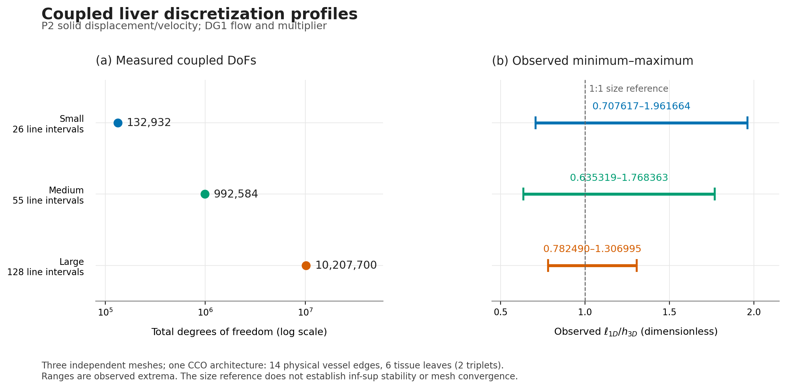
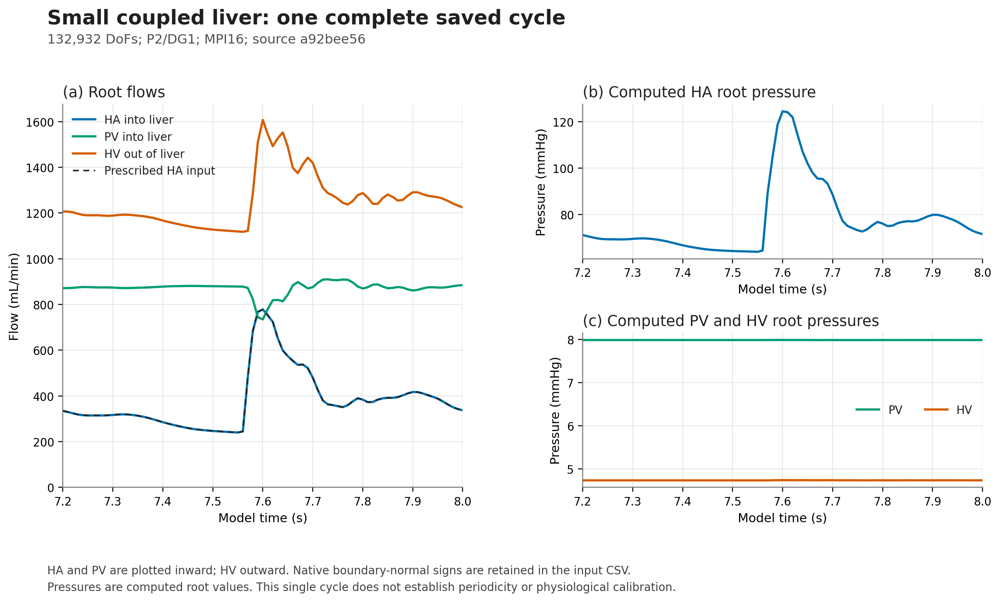
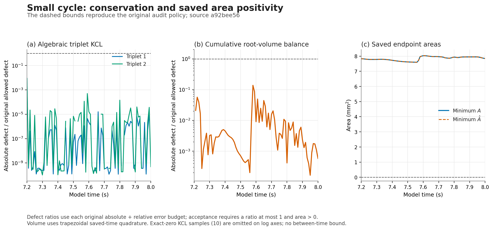
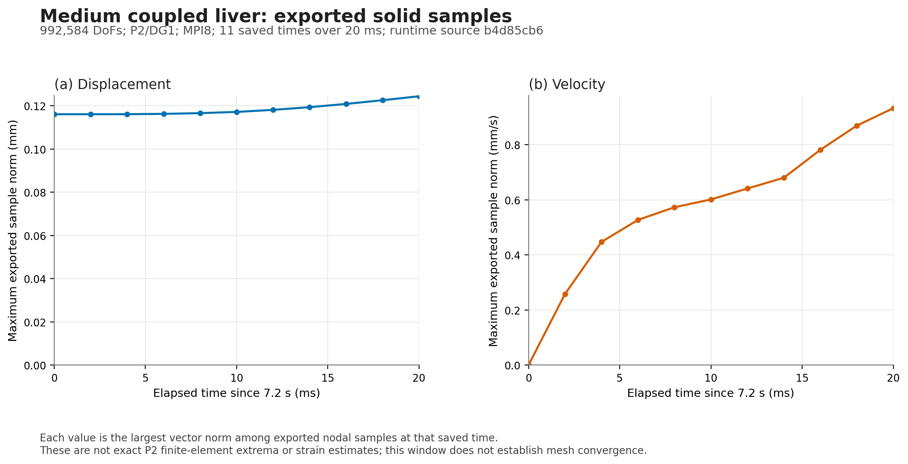

# Coupled IRCAD12 liver profiles

This tutorial couples liver mechanics to hepatic arterial (HA), portal venous
(PV) and hepatic venous (HV) networks. It provides a small working case and
three P2/DG1 problem sizes, from 132,932 to 10,207,700 coupled degrees of
freedom. The same physical CCO network is discretized against each tissue
mesh. The exterior uses Robin support to represent surrounding tissue.

The anatomy is 3D-IRCADb-01 case 12.[^1] The vascular roots and material
properties are modelling surrogates; this is not a patient calibration.
For surface preparation and the separate dense-tree growth example, see
[Vascularize a liver](../../doc/tutorials/liver-vascularization.md).
The case below uses three interior feeder stubs and two tissue territories,
rather than the dense imported trees in that example.

## Run from release assets

The [scaling research release](https://github.com/luca-heltai/immersx/releases/tag/liver-icar-scaling-2026-11-06)
contains the generated tissue meshes, physical network archive, inlet data,
parameters, scalar results and provenance. Its self-contained input archive is
`liver-icar-inputs.tar.gz`. The separate
[baseline release](https://github.com/luca-heltai/immersx/releases/tag/liver-icar-start-2026-11-05)
retains the earlier complete small-case interval and its original report. The
[scaling tracker](https://github.com/luca-heltai/immersx/issues/343) records
the accepted runs, source revisions, audits and later scaling results.
Keep the reports, checksums, source attribution and original IRCAD licence
with the anatomical data. The source licence is
[CC BY-NC-ND 4.0](https://creativecommons.org/licenses/by-nc-nd/4.0/).[^1]

Build `metric_flow_x_elastodynamics` with compatible MetricFlowX, SUNDIALS and
MPI libraries. MetricFlowX must contain the physical corrections from
[PR #87](https://github.com/luca-heltai/metric-flow-x/pull/87): reversed-root
RCR orientation and other-terminal external pressures in linked boundary
equations. The recorded backend includes revision
`129cf1107258670457acabfeb288adfea768a3bc`. The coupled application and native
output contracts are versioned in the references.[^3][^4]

~~~bash
cmake -S . -B /absolute/path/to/build -G Ninja \
  -DCMAKE_BUILD_TYPE=Release \
  -DENABLE_COUPLED_PROBLEMS=OFF \
  -DMetricFlowX_DIR=/absolute/path/to/metric-flow-x/lib/cmake/MetricFlowX
cmake --build /absolute/path/to/build \
  --target liver_vascular metric_flow_x_elastodynamics -j 4
~~~

Extract `liver-icar-inputs.tar.gz` and pass its
`liver-icar-inputs/assets` directory as `--assets-dir`:

~~~text
assets/
  meshes/small.msh
  meshes/medium.msh
  meshes/large.msh
  network/manifest
  network/part-*.txt
  inputs/inlet_ha.csv
  inputs/liver.stl
  inputs/arterial.vtk
  inputs/venous.vtk
  inputs/portal.vtk
~~~

Keep the bundle's attribution, input provenance, report and checksums alongside
these files. Retain the original IRCAD attribution and licence.

Prepare a short small-case run from the repository root:

~~~bash
python3 tutorials/liver_icar/run_case.py \
  --build-dir /absolute/path/to/build \
  --assets-dir /absolute/path/to/assets \
  --output /absolute/path/to/new-small-run \
  --profile small --duration .002 --prepare-only
~~~

Inspect `common.prm`, `parameters.prm` and `run.json`. To execute through the
runner, omit `--prepare-only` and choose another new output directory. The
runner refuses existing output directories, resolves paths absolutely,
checks CSV time coverage and records input/parameter hashes. Results go to
`run.log`. The default asset root is `<build>/data/liver_icar/assets`.

| Profile | Solid / flow / multiplier | Total coupled DoFs | Default solver and ranks | Duration / output period |
| --- | --- | ---: | --- | ---: |
| `tiny` | P1 / DG0 / DG0 | 20,000 | UMFPACK, 1 | 0.8 s / 10 ms |
| `small` | P2 / DG1 / DG1 | 132,932 | MUMPS, 4 | 0.8 s / 10 ms |
| `medium` | P2 / DG1 / DG1 | 992,584 | Iterative, 8 | 2 ms / 2 ms |
| `large` | P2 / DG1 / DG1 | 10,207,700 | Iterative, 112 | 2 ms / 2 ms |

All runs start at 7.2 s. Medium and large default to short startup checks;
consistent initialization can still be expensive. The recorded medium
2 ms and 20 ms runs took 703.78 s and 6056.93 s respectively on eight ranks.
These are observed wall times, not a performance guarantee.

Use `--profile medium --duration .02` for the audited extended check: its
default 2 ms output period gives 11 saved times. An explicit `--duration`
must lie in `(0, 0.8]` s. `--output-period` must be finite and positive;
the rendered period is the smaller of this value and the requested duration.
Both increments must advance the start time in floating-point arithmetic.
For example, `--profile large --duration .8 --output-period .01` requests
81 saved times over 7.2–8 s. A full medium or large beat has not been validated.
The inlet is neither repeated nor extrapolated.

`run.json` records the requested/effective period and
`current_runtime_audited_duration_s`. Its `validation_scope` identifies the
tested solver and MPI count. The current tiny audit used an iterative
four-rank override with flow/Schur limits 2048/512, distinct from the default
serial UMFPACK recipe. The complete small beat is the earlier
`a92bee56` reference. `unvalidated_scale_profile` flags medium/large
requests beyond their audited intervals; every new run still needs its
numerical checks. `--ranks` overrides all defaults except tiny's one-rank
UMFPACK requirement. Match the ranks to the available CPU and memory allocation.

## Geometry, CCO and the three spatial scales

The physical archive has 14 vessel edges: three supplied feeder stubs and
11 generated edges. It contains three genuine degree-three CCO
bifurcations, one per vascular role. Six tissue leaves belong to two common
HA/PV/HV triplets; no tissue leaf is left unlinked. CCO supplies the
constructive growth and optimization procedure.[^14][^15] Two territories
do not establish whole-organ vascular coverage or resolve the sinusoids.

The prepared liver surface is in metres. Gmsh generates independent
tetrahedral remeshes with target edge lengths 12, 4.5 and 1.8 mm.
The physical archive is then redistributed and subdivided against each final
background, without regrowing it.

| P2/DG1 profile | Tetrahedra | Volume (L) | Displacement + velocity DoFs | Numerical 1D intervals | Flow / multiplier DoFs |
| --- | ---: | ---: | ---: | ---: | ---: |
| Small | 13,351 | 1.5154 | 132,672 | 26 | 208 / 52 |
| Medium | 111,250 | 1.5273 | 992,034 | 55 | 440 / 110 |
| Large | 1,222,373 | 1.5293 | 10,206,420 | 128 | 1024 / 256 |

Tiny reuses the small mesh with P1 mechanics: 19,818 displacement/velocity
DoFs, 156 flow DoFs and 26 multiplier DoFs. The independent remeshes have
slightly different discrete domains; this must be accounted for in a
convergence study.

For every crossed tissue cell, the observed numerical interval length
divided by background-cell diameter lies in 0.707617–1.961664,
0.635319–1.768363 and 0.782490–1.306995 for small, medium and large.
The target ratio is one, with requested bounds 0.5–2. The four-rank archive
reload checks found no short or exterior intervals. This verifies geometric
comparability, not a positive discrete inf-sup constant. Recheck these ratios
and the coupled solution whenever either discretization changes.



*The same 14-edge physical architecture gives 26, 55 and 128 numerical
intervals. Horizontal ranges are observed extrema, not uncertainty bands.
The dashed line is a 1:1 size reference. [SVG figure](../../doc/_static/liver-icar/scale-profiles.svg).*

## What the coupled model represents

The unknowns are solid displacement $u$, solid velocity $v$, native flow area
$A$ and axial velocity $U$, and a scalar wall multiplier $\lambda$.
The execution adapter solves the canonical residual
$F(t,y,\dot y)=0$. The solid uses first-order elastodynamics; the flow uses
the native 1D model with an elastic square-root pressure–area law.

The nonlinear radial displacement is

$$
\delta R(A)=\sqrt{A/\pi}-\sqrt{A_0/\pi}.
$$

The wall lift tests compatibility between this displacement and the radial
solid displacement. The multiplier enters solid momentum and native
external-pressure assembly with the signs defined in the
[coupling formulation](../../doc/tutorials/metric-flow-x-elastodynamics-coupling.md).
In that convention, native external pressure receives $-\lambda$.
It affects volume, flux, boundary and junction equations.[^4]

Each triplet has one common microvascular pressure and three positive
resistive arms. With $g_i=1/R_i$, eliminating that pressure gives

$$
g_{ij}=\frac{g_i g_j}{\sum_k g_k},\qquad
Q_i=\sum_{j\ne i}g_{ij}(p_i-p_j),\qquad
\sum_i Q_i=0.
$$

Here $Q_i$ points outward from each 1D network into the bed. Arterial and
portal supplies therefore equal venous drainage in a steady compartment.
The closure is a reduced hydraulic connection, consistent with the purpose
of lumped hepatic models; it is not a resolved capillary bed.[^7]
The archive importer rejects unconnected tissue leaves.

## MOX input and hydraulic boundaries

The upstream source is the physiological version-3 MOX-driven full ADAVN
run, using MetricFlowX revision
`9e013df07eeaa585bd140bbd629bfbf4d9a5bee4`. The ADAVN anatomy, terminal
mapping, MOX input and comparison campaign have separate provenance.[^2][^3][^5][^6]

The HA inlet sums eight liver `ORG11` terminals: 900, 901, 903, 904, 905, 906,
907 and 908. Terminal 902 is the cystic artery and is excluded. Negating
native outward arterial terminal flow makes positive liver supply. The
selected input has 81 samples over 7.2–8 s. The smaller 2 ms output period
evaluates the same interpolant; it does not add upstream measurements.
No phase alignment, clipping, periodic extension or extrapolation is used.

| Final-beat upstream quantity | Recorded mean |
| --- | ---: |
| HA flow | 6.33907845749e-6 m³/s = 380.345 mL/min |
| Splanchnic supply proxy | 1.44973434145e-5 m³/s = 869.841 mL/min |
| Flow-weighted HA terminal pressure | 10064.536060 Pa |
| Central IVC outlet pressure | 629.597396 Pa |

The portal proxy sums 175 other arterial terminals assigned to the hepatic
venous-drain compartment. It sizes the reference bed flows; it is not a
resolved portal transit model or a prescribed portal waveform. Its
69.5769% fraction and total design flow 2.0836421871998312e-5 m³/s are
reference construction inputs. As a magnitude comparison, a 4D-flow study
reported portal flow 1.0±0.2 L/min in 44 fasting healthy adults, with a
0.7–1.4 L/min reference range. This does not validate the proxy's mapping
or waveform.[^8]

Only HA flow is prescribed as a history. PV flow is solved from an assumed
8 mmHg reservoir (1066.57909932 Pa); HV drainage is solved against the
central IVC mean 629.59739556 Pa, about 4.7224 mmHg. The IVC outlet is
boundary 1508, rather than peripheral hepatic-vein entrance 1506.
Each root reservoir has series resistance 1e5 Pa s/m³. Computed root pressure
therefore includes the resistive drop.

The upstream summed supply and peripheral HV discharge differ by 18.66%
over the selected beat. Prescribing all three histories independently would
impose an inconsistent steady balance. The present model imposes HA flow
and solves the other two flows.

## Material data and Robin support

The data below define a homogeneous tissue and uniform vessel-wall
surrogate. They are not measurements of the IRCAD subject.

| Quantity | Configured value | Basis |
| --- | ---: | --- |
| Blood density / dynamic viscosity | 1060 kg/m³ / 0.00371 Pa s | Modelling density and liver reference viscosity[^17][^7] |
| Root radii, HA / HV / PV | 2.2 / 6.5 / 4.9 mm | Literature surrogates on synthetic stubs[^7] |
| Wall Young modulus / thickness-to-radius ratio | 400000 Pa / 0.1 | Hepatic wall-modulus scale and thin-wall surrogate[^9] |
| Friction profile parameter | $\xi=2$ | Poiseuille coefficient $8\pi\mu$ |
| Tissue density | 1060 kg/m³ | Tissue-property compilation[^11] |
| Tissue Young modulus / Poisson ratio | 6000 Pa / 0.49 | Stiffness-scale choice and near incompressibility[^10] |
| Tissue Lamé $\mu_s$ / $\lambda_s$ | 2013.4228188 / 98657.7181208 Pa | Derived from $E,\nu$ |
| Native tissue viscosity | 4.2 Pa s | Conditional shear-viscosity mapping[^16] |
| Exterior spring coefficient | 1e5 Pa/m | Surrounding-tissue assumption[^12][^13] |

The archived material lists use **HA, HV, PV order**. Wall reference
pressures are 10064.536060, 629.597396 and 1066.579099 Pa in that order.
These pressure–area references and the hydraulic reservoir pressures have
different roles. They do not reconstruct patient-specific prestress.

The selected shear modulus is 2.013 kPa. A liver MRE study reported healthy
shear elasticity 2.25±0.43 kPa; another hepatic model used vessel-wall
elasticities 1.6e5–4e5 Pa.[^10][^9] These comparisons support parameter
scales, not a cardiac-frequency calibration of this anatomy.

Pearson and coauthors report median shear viscosity 2.1 Pa s at 50 Hz in
22 healthy volunteers, with IQR 1.7–2.4 Pa s.[^16] ImmersX assembles

$$
\eta_{\rm native}\int_\Omega
  \varepsilon(v):\varepsilon(w)\,dx.
$$

Matching $2\eta_{\rm shear}\varepsilon(v)$ gives native
$\eta=2\eta_{\rm shear}=4.2$ Pa s.[^4] Using that constant at the 1.25 Hz
cardiac time scale is an extrapolation. Rayleigh damping is zero; the
runner's `--solid-viscosity 0` selects a separate undamped control.
No independent volumetric viscosity was identified.

On the entire exterior, boundary id 0, the model applies

$$
\sigma(u,v)n+k_R u=0,\qquad k_R=10^5\ {\rm Pa/m},
$$

with no prescribed displacement. Spring support has precedent in vascular
FSI and liver constraint identification, but the coefficient is a declared
assumption.[^12][^13] Here it corresponds to
$E_{\rm ext}/L_{\rm ext}=2000\ {\rm Pa}/0.02\ {\rm m}$ and gives 100 Pa
traction at 1 mm displacement. Sensitivity to this support remains to be
checked.

## Time integration and solver controls

`use_y_dot` holds the initial derivative at zero and solves
$F(7.2,y,0)=0$. SUNDIALS uses zero derivative weight in this correction.[^21]
This is an equilibrium start under the initial boundary data, not a periodic
coupled state inherited from the upstream circulation.

| Control | Value |
| --- | ---: |
| Relative LTE tolerance | 1e-4 |
| Area absolute-tolerance fraction | 1e-5 of native reference area |
| Native flow / solid velocity absolute tolerances | 1e-6 m/s |
| Capacitor / wall-pressure absolute tolerances | 0.01 Pa |
| Displacement absolute tolerance | 1e-8 m |
| Initial step / maximum BDF order | 0.001 s / 2 |
| Newton convergence coefficient | 1e-4 |

Algebraic variables are suppressed in the LTE test. Their assigned pressure
weights are not direct pressure-error bounds. `--tolerance-scale .1` scales
all absolute tolerances and the relative tolerance together in a separate
output directory. It is a tolerance-sensitivity control, not a spatial
convergence test.

The recipe stops IDA at every requested output time, retaining its BDF
history. This keeps saved states at internal step endpoints, where the
nonlinear algebraic constraints are solved. Output cadence therefore
belongs to the reproducible numerical configuration.

### Reuse fixed linear wall assembly

The application's two fixed linear wall pairings opt into
`with_cached_assembly()`. Their finite-element operator $B$ is assembled once,
while current state values and affine constraint offsets are still evaluated.
The contract requires fixed mesh, mapping, reference geometry, support,
finite-element space and homogeneous constraint coefficients. If these
change, rebuild the term; this option does not automatically invalidate it.
The nonlinear $\sqrt A$ trial-state map is evaluated dynamically.[^4]

This assembly retention is distinct from the Schur snapshot cache below.
It retains a fixed linear weak term; the Schur cache is rebuilt with a new
retained Jacobian/preconditioner snapshot.

### Direct and bounded iterative solvers

Small uses MUMPS with 100% extra workspace relative to the native estimate.
This is allocation headroom, not a memory limit in MB.[^18] Every returned
direct correction is checked against the retained Jacobian:
$\|Jx-b\|_2\le10^{-8}\|b\|_2$. A historical insufficient-workspace solve
returned a zero correction without a native exception; the independent
residual check rejects that result.

For iterative initialization, the static displacement–velocity pair must be
retained even though its displacement diagonal is zero. The pair
$[0,-M;K,D]$ is invertible with the chosen support. Static and positive-weight
Schur construction, elimination and recovery use the same fixed primal
actions; independent multilevel tests check the physical multiplier
row.[^22][^23]

Medium and large select these ordinary parameters under
`MetricFlowSystem<1, 3>/IDA parameters/Linear solver`:

~~~text
set Maximum replicated flow inverse DoFs = 2048
set Maximum materialized Schur DoFs = 512
~~~

The flow fields have 440/1024 DoFs and multiplier fields 110/256 DoFs.
Replicated LAPACK LU acts on the complete small flow block, supports the true
transpose, and includes ranks without owned rows.[^19] Above the explicit
limit the application keeps ILU; zero keeps ILU at every size. The native
standalone `Use direct solver` parameter does not choose the coupled inverse.

The Schur operator still uses approximate tissue inverses. Its bounded dense
column matrix is sampled once per Jacobian snapshot; it is not the exact
Schur complement of the full Jacobian. Storage is quadratic only in the
selected small-field size on every rank. Every inner GMRES solve is checked
with the original Schur action in the original left-preconditioned metric.
Up to three residual corrections share the original iteration budget and
the unchanged relative target `1e-9`. The outer true-Jacobian residual check
also remains active.[^20][^24]

In a C++ application, configure the public adapter and descriptor before
initialization:

~~~cpp
using FlowVector = MetricFlowX::VectorType;
adapter.set_schur_materialization_limit(512);
auto flow = ImmersX::metric_flow_x(flow_problem);
flow.preconditioner_factory = [](const auto &matrix, const auto &prototype) {
  return ImmersX::make_replicated_direct_preconditioner<FlowVector>(
    matrix, prototype, 2048);
};
const auto fields = adapter.add(flow, "blood-flow");
~~~

The direct helper requires a nonempty square MPI field block within its bound
and a matching vector layout. Callers select their fallback before invoking
this strict helper. An empty descriptor factory retains the ordinary ILU
registration.

## Recorded results and independent checks

| Recorded case | Numerical source | DoFs | MPI ranks | Interval / outputs | Wall time |
| --- | --- | ---: | ---: | --- | ---: |
| Small complete interval | `a92bee56` | 132,932 | 16 | 7.2–8 s / 81 | 1139.23 s |
| Tiny iterative override | `b4d85cb6` | 20,000 | 4 | 7.2–7.202 s / 2 | 31.486 s |
| Small MUMPS startup | `b4d85cb6` | 132,932 | 4 | 7.2–7.202 s / 2 | 65.767 s |
| Medium startup | `b4d85cb6` | 992,584 | 8 | 7.2–7.202 s / 2 | 703.777 s |
| Medium extended check | `b4d85cb6` | 992,584 | 8 | 7.2–7.22 s / 11 | 6056.929 s |
| Large startup | `b4d85cb6` | 10,207,700 | 112 | 7.2–7.202 s / 2 | 3094.707 s |

These are recorded CPU MPI runs with one application/BLAS/OpenMP thread per
rank. Concurrent work, different solvers, MPI counts and time windows prevent
a strong/weak scaling or statistical speedup claim. Later test-identifier and
recipe commits do not relabel the frozen numerical runs.



*Small P2/DG1, `a92bee56`, MPI16. HA and PV flow are shown into the liver and
HV flow out; the source CSV retains native outward-normal signs. The dashed
HA curve is the prescribed input. Root pressures are computed values, with
m³/s converted to mL/min by $60\,000\,000$ and Pa to mmHg by
$133.322387415$. This one saved cycle does not establish periodicity.
[SVG figure](../../doc/_static/liver-icar/small-haemodynamics.svg).*

### Check beds, storage, input and fields separately

The strict audit checks each bed's KCL, rather than relying on cancellation
in an all-terminal sum. Root storage uses
$\Delta V+\int\sum_{\rm roots}Q_{\rm out}\,dt$ with saved-time trapezoidal
quadrature. This includes output-cadence error and is distinct from an
instantaneous assembled conservation residual.

For the small complete interval, maximum relative bed KCL is 9.83658e-9
and maximum cumulative root-volume defect is 0.0690147% of integrated
throughflow. Minimum DG1 cell and trace areas are 7.59880e-6 and
7.59893e-6 m². Positive affine DG1 endpoint areas establish positivity inside
each exported cell at each saved time, without a between-output guarantee.



*Defects are divided by their original per-sample absolute-plus-relative
allowed defects. The dashed ratio one is the original acceptance bound;
the area positivity bound is zero. Exact-zero KCL samples are retained in
the CSV and omitted on logarithmic axes.
[SVG figure](../../doc/_static/liver-icar/small-conservation.svg).*

The canonical completed-run gate requires strict CSV conservation, flow-VTU
positivity/volume and declared cadence, together with exit zero from all four
postprocessing scripts. Inlet tracking is recorded as `measured` and
individual arm-law residuals as `diagnostic_only`; their errors are reported
without inventing additional acceptance thresholds. A historical dense-output
P2 run exited zero but failed strict bed KCL. Solver exit status alone is
therefore insufficient.

The medium 20 ms check has maximum relative KCL 3.33617e-8 and cumulative
relative root-volume defect 0.0279834%. It completes 19 IDA steps, 62 Newton
iterations, 13 Jacobians and 64 linear solves, with zero error/convergence
failures. Algebraic and implementation gates also include dense forward and
transpose oracles, nonexact multilevel AMG, constrained rows, empty MPI
ownership, and 246 selected native quick CTest entries across Release/Debug
and MPI. These are code and numerical checks, not physiological validation.



*Medium P2/DG1, `b4d85cb6`, MPI8, eleven saved times over 20 ms.
Each marker is the maximum vector norm among exported nodal samples.
These are not exact extrema of the P2 finite-element field or strain
estimates. [SVG figure](../../doc/_static/liver-icar/medium-solid-samples.svg).*

### Reproduce the figures

The plot script reads compact scalar snapshots and verifies their hashes.
It does not rerun the coupled problem or read the 3D VTK series.

~~~bash
python3 -m venv /tmp/immersx-liver-plots
/tmp/immersx-liver-plots/bin/pip install \
  -r tutorials/liver_icar/plots/requirements.txt
/tmp/immersx-liver-plots/bin/python \
  tutorials/liver_icar/plots/plot_results.py \
  --output-dir /absolute/path/to/build/liver-figures
~~~

`tutorials/liver_icar/plots/inputs/provenance.json` records source artifacts,
runtime revisions, selected fields, transformations and hashes. The script
writes PNG, SVG and a render manifest. The default output directory is
`doc/_static/liver-icar`; `--inputs` supports relocated snapshots. The raw
source records and exact audit commands remain in the release provenance.
For the medium extension, the scaling bundle retains
`audits/clean-api-medium-20ms-mpi8/clean-api-medium-20ms-mpi8-commands.json`,
which records the four exact auditor subprocess arrays. The original wrapper is
`provenance/postprocessing/audit_liver_scale_case_v3.py`. Its recorded GPU04
and virtual-environment paths are execution provenance. Use the underlying
scripts with explicit relocated paths; the wrapper retains its original,
nonportable directory layout. Portable auditor copies are under the addendum
`scripts/` directory. The physical mapping tables are
`audits/network-mapping/{triplets-0.csv,terminals-0.csv,vessels-0.csv}`;
use that directory for `--archive-dir` and the selected run's actual
`flow/network_terminals.csv`. Their original source paths and hashes are retained.

## Open the recorded fields in ParaView

The full 3D result series are retained on `gpu04-codex` under
`/data/home/lheltai/codes/liver-icar-20261105`. Open the following collections:

~~~text
# Small complete interval, a92bee56, MPI16
/data/home/lheltai/codes/liver-icar-20261105/v12-mumps100-small-fullbeat-mpi16/solid/solid.pvd
/data/home/lheltai/codes/liver-icar-20261105/v12-mumps100-small-fullbeat-mpi16/flow/flow.pvd

# Medium 20 ms, b4d85cb6, MPI8
/data/home/lheltai/codes/liver-icar-20261105/clean-production-gates/medium-20ms-mpi8/solid/solid.pvd
/data/home/lheltai/codes/liver-icar-20261105/clean-production-gates/medium-20ms-mpi8/flow/flow.pvd

# Large 2 ms, b4d85cb6, MPI112
/data/home/lheltai/codes/liver-icar-20261105/clean-production-gates/large-2ms-mpi112/solid/solid.pvd
/data/home/lheltai/codes/liver-icar-20261105/clean-production-gates/large-2ms-mpi112/flow/flow.pvd
~~~

The corresponding small startup and tiny iterative diagnostic are under
`clean-production-gates/small-2ms-mpi4` and
`clean-production-gates/tiny-2ms-mpi4`, with the same `solid/solid.pvd` and
`flow/flow.pvd` layout. Each case also has
`flow/pressure_jump.pvd` for the diagnostic pressure-jump output.
The checked `paraview-results-index.json` in the results root records all
times, paths, arrays and piece counts.

Solid collections point directly to shared VTU files containing internal MPI
pieces. Flow collections point to PVTU files and external VTU pieces. Open the
collection rather than one arbitrary piece: 92 of the 112 large-case flow
pieces are empty, while all 112 solid pieces are nonempty. When copying a
series, preserve its complete directory tree and relative references.

| Dataset | Fields used for inspection |
| --- | --- |
| Solid | `displacement`: vector, m; `velocity`: vector, m/s |
| Flow | `area` and `A_hat`: m²; `velocity` and `U_hat`: scalar m/s; `pressure`: Pa |
| Labels | `subdomain` and `vessel_id` |
| Diagnostic | `flow/pressure_jump.pvd`, direct shared VTU series |

Coordinates were verified unchanged within all 98 saved solid VTUs across the
five cases. Apply **Warp By Vector**, select `displacement` and scale factor
**1** to show physical deformation in metres. Flow velocity is an axial
scalar, whereas solid velocity is a three-component vector. A Tube filter
is a display choice for the line grid; the
[area-scaled Tube recipe](../../doc/how-to/paraview-area-tube.md) explains
physical-radius visualization. Preserve duplicated DG endpoints when
measuring fields; merging or averaging them changes the exported data.
Arrays named `unused*` are not physical observables.

P2 values are exported samples. Gradients of the visualization interpolant
do not establish exact P2 strains, spatial extrema or a mechanical energy
balance. The compact scalar plotting snapshots and released meshes do not
replace the full server-side field series.

## Regenerate the volume and physical archive

Follow the existing [IRCAD preparation tutorial](../../doc/tutorials/liver-vascularization.md)
with a new preparation directory and `--with-portal`. It downloads and checks
case 12, converts millimetres to metres and writes `liver.stl`. Use a fresh
asset root for regeneration; do not mix it with an extracted release bundle.
After setting `BUILD` to an absolute build directory:

```bash
export BUILD=/absolute/path/to/build
export ASSETS="$BUILD/data/liver_icar/assets"
micromamba run -n ircad-prep python scripts/prepare_ircad_liver.py \
  "$BUILD/ircad12-prepared" --with-portal
mkdir -p "$ASSETS/inputs"
cp "$BUILD/ircad12-prepared/liver.stl" "$ASSETS/inputs/liver.stl"
python3 - "$ASSETS/inputs" <<'PY'
from pathlib import Path
import sys
root = Path(sys.argv[1])
seeds = {
    'arterial': ((.100, .160, .200), (.120, .160, .200), .0022),
    'venous': ((.150, .140, .180), (.130, .140, .180), .0065),
    'portal': ((.100, .185, .200), (.120, .185, .200), .0049),
}
for role, (a, b, radius) in seeds.items():
    points = '\n'.join(' '.join(map(str, point)) for point in (a, b))
    (root / f'{role}.vtk').write_text(
        '# vtk DataFile Version 3.0\nIRCAD12 interior feeder stub\nASCII\n'
        'DATASET UNSTRUCTURED_GRID\nPOINTS 2 double\n' + points + '\n'
        'CELLS 1 3\n2 0 1\nCELL_TYPES 1\n3\nPOINT_DATA 2\n'
        'SCALARS Radius double 1\nLOOKUP_TABLE default\n'
        f'{radius}\n{radius}\n'
        'SCALARS Root int 1\nLOOKUP_TABLE default\n1\n0\n'
        'SCALARS Grow int 1\nLOOKUP_TABLE default\n0\n1\n')
PY
```

The stubs are interior modelling choices, not image-extracted centreline trees.
The tissue surface remains the prepared IRCAD surface. CMake configures all
`.prm.in` files under `data/liver_icar`; use their generated build-tree copies:

```bash
cmake -S . -B "$BUILD" -DCMAKE_BUILD_TYPE=Release \
  -DMetricFlowX_DIR=/absolute/path/to/metric-flow-x/lib/cmake/MetricFlowX
cmake --build "$BUILD" --target liver_vascular metric_flow_x_elastodynamics -j 4
mpirun -np 1 "$BUILD/liver_vascular" "$BUILD/data/liver_icar/mesh-small.prm"
mpirun -np 1 "$BUILD/liver_vascular" "$BUILD/data/liver_icar/mesh-medium.prm"
mpirun -np 1 "$BUILD/liver_vascular" "$BUILD/data/liver_icar/mesh-large.prm"
mkdir "$ASSETS/meshes"
cp "$BUILD/test_output/liver_icar/mesh-small/liver.msh" "$ASSETS/meshes/small.msh"
cp "$BUILD/test_output/liver_icar/mesh-medium/liver.msh" "$ASSETS/meshes/medium.msh"
cp "$BUILD/test_output/liver_icar/mesh-large/liver.msh" "$ASSETS/meshes/large.msh"
mpirun -np 1 "$BUILD/liver_vascular" "$BUILD/data/liver_icar/generate.prm"
micromamba run -n ircad-prep python scripts/check_liver_vascular.py "$ASSETS/inputs" \
  "$BUILD/test_output/liver_icar/generation" --triplets 2 \
  --separation .015 --portal-separation .015 \
  --portal-flow-fraction .69576933619234205 --viscosity .00371
cp -a "$BUILD/test_output/liver_icar/generation/network" "$ASSETS/network"
```

The mesh-only profiles generate each volume from the prepared STL. Physical
network generation then reads the exact small mesh. It uses a 35 mm startup
extension, a 10 mm minimum physical branch length, 32 candidate vessels,
ten local optimization steps, random seed 23 and a 5,000-sample insertion
budget. The accepted two-triplet archive was generated on one rank. The
four-rank trial with the same seed exhausted its sampling budget; use the
serial command above for reproduction. The saved archive was successfully
redistributed and rediscretized on four ranks at all three mesh sizes.

Every generation output directory must be new. The physical generator exports
`liver.msh`, the `network/` archive and diagnostics. The three bifurcation nodes
have degree three and generated provenance, as do their incident edges. There
are no unused tissue leaves. The minimum physical branch length is 10.028 mm;
the independent sampled wall margin is at least 5.769 mm.

Retain the exact `inputs/inlet_ha.csv` and its source extraction manifest from
the release. The coupled importer redistributes and rediscretizes this same
physical network against each chosen background; it does not regrow it.

## Limits and next refinement

The two compartments are a coarse hydraulic closure and do not establish
whole-organ perfusion. Tissue is homogeneous and isotropic, the wall law does
not describe venous collapse, and viscosity at cardiac frequency is an
assumption. The near-incompressible displacement space may lock.

The accepted windows are the recorded startup intervals and the earlier
small complete cycle. They do not prove periodicity, spatial convergence or
a uniform mixed inf-sup bound. Before increasing territories or refining
either grid, retain input provenance, regenerate and check local length
ratios, compare physical residuals and solution changes, and repeat the
independent field and conservation audits. The baseline report also retains
the separate P1 tolerance controls and rejected historical diagnostics.

## References

References 1–18 retain the baseline sources; references 19–24 pin the
additional numerical software and reviewed checkpoints used for the scaling study.
The reports retain the precise source checkpoints and raw numerical evidence.

[^1]: Soler L, Hostettler A, Agnus V, Charnoz A, Fasquel J, Moreau J, Osswald A,
    Bouhadjar M, Marescaux J. *3D image reconstruction for comparison of
    algorithm database: A patient specific anatomical and medical image
    database*. IRCAD technical report, 2010.
    [Official 3D-IRCADb-01 dataset, case table and attribution](https://www.ircad.fr/research-and-development/data-sets/liver-segmentation-3d-ircadb-01/).

[^2]: Müller LO, Watanabe SM, Toro EF, Feijóo RA, Blanco PJ. *An anatomically
    detailed arterial-venous network model. Cerebral and coronary circulation*.
    Frontiers in Physiology 14, 1162391, 2023.
    [DOI: 10.3389/fphys.2023.1162391](https://doi.org/10.3389/fphys.2023.1162391).

[^3]: MetricFlowX. *Full ADAVN tutorial* and *Outputs*, source revision
    `9e013df07eeaa585bd140bbd629bfbf4d9a5bee4`.
    [Tutorial and source mapping](https://github.com/luca-heltai/metric-flow-x/blob/9e013df07eeaa585bd140bbd629bfbf4d9a5bee4/tutorials/05_adavn_full/README.md),
    [terminal output contract](https://github.com/luca-heltai/metric-flow-x/blob/9e013df07eeaa585bd140bbd629bfbf4d9a5bee4/doc/outputs.md).

[^4]: ImmersX. *MetricFlowX–elastodynamics application*, reviewed revision
    `a92bee56c62713eb15ba5e8ea7412bac66723898`.
    [Application source](https://github.com/luca-heltai/immersx/blob/a92bee56c62713eb15ba5e8ea7412bac66723898/apps/app_metric_flow_x_elastodynamics.cc),
    [material assembly](https://github.com/luca-heltai/immersx/blob/a92bee56c62713eb15ba5e8ea7412bac66723898/source/elastodynamics.cc#L800),
    [semidiscrete velocity residual](https://github.com/luca-heltai/immersx/blob/a92bee56c62713eb15ba5e8ea7412bac66723898/include/immersx/physics/elastodynamics_semidiscrete.h#L159).

[^5]: deal.II-X. *MOX input dataset and supplied legends/parameters*.
    [Dataset release](https://github.com/dealii-X/dealii-X/releases/tag/assets).

[^6]: deal.II-X. *Version 3 MOX–circulation comparison campaign*, 2026.
    [Scientific result and method record](https://github.com/dealii-X/dealii-X/issues/42#issuecomment-6580108970),
    [public comparison release](https://github.com/dealii-X/dealii-X/releases/tag/mox-calibration-v3-2026-11-02).

[^7]: Tithof J, Pruett TL, Rao JS. *Lumped parameter liver simulation to predict
    acute haemodynamic alterations following partial resections*. Journal of
    the Royal Society Interface 20(207), 20230444, 2023.
    [DOI: 10.1098/rsif.2023.0444](https://doi.org/10.1098/rsif.2023.0444).

[^8]: Huang A, Roberts GS, Roldán-Alzate A, Wieben O, Reeder SB, Oechtering TH.
    *Reference values for 4D flow magnetic resonance imaging of the portal
    venous system*. Abdominal Radiology 48(6), 2049–2059, 2023.
    [DOI: 10.1007/s00261-023-03892-3](https://doi.org/10.1007/s00261-023-03892-3).

[^9]: Ma R, Hunter P, Cousins W, Ho H, Bartlett A, Safaei S. *Anatomically based
    simulation of hepatic perfusion in the human liver*. International Journal
    for Numerical Methods in Biomedical Engineering 35(9), e3229, 2019.
    [DOI: 10.1002/cnm.3229](https://doi.org/10.1002/cnm.3229).

[^10]: Asbach P, Klatt D, Schlosser B, Biermer M, Muche M, Rieger A,
    Loddenkemper C, Somasundaram R, Berg T, Hamm B, Braun J, Sack I.
    *Viscoelasticity-based staging of hepatic fibrosis with multifrequency MR
    elastography*. Radiology 257(1), 80–86, 2010.
    [DOI: 10.1148/radiol.10092489](https://doi.org/10.1148/radiol.10092489).

[^11]: Mast TD. *Empirical relationships between acoustic parameters in human
    soft tissues*. Acoustics Research Letters Online 1(2), 37–42, 2000.
    [DOI: 10.1121/1.1336896](https://doi.org/10.1121/1.1336896).
    Table 1 compiles liver density from ICRU Report 61 (1998).

[^12]: Moireau P, Xiao N, Astorino M, Figueroa CA, Chapelle D, Taylor CA,
    Gerbeau J-F. *External tissue support and fluid–structure simulation in
    blood flows*. Biomechanics and Modeling in Mechanobiology 11(1–2),
    1–18, 2012; online 2011.
    [DOI: 10.1007/s10237-011-0289-z](https://doi.org/10.1007/s10237-011-0289-z).

[^13]: Xu T, Lei Y, Cheng X, Li M. *Identification of Young’s modulus and
    equivalent spring constraint boundary conditions of the soft tissue with
    locally observed displacements for endoscopic liver surgery*. Computer
    Methods in Biomechanics and Biomedical Engineering 25(4), 439–454,
    2022; online 2021.
    [DOI: 10.1080/10255842.2021.1959556](https://doi.org/10.1080/10255842.2021.1959556).

[^14]: Schreiner W, Buxbaum PF. *Computer-optimization of vascular trees*. IEEE
    Transactions on Biomedical Engineering 40(5), 482–491, 1993.
    [DOI: 10.1109/10.243413](https://doi.org/10.1109/10.243413).

[^15]: Karch R, Neumann F, Neumann M, Schreiner W. *A three-dimensional model
    for arterial tree representation, generated by constrained constructive
    optimization*. Computers in Biology and Medicine 29(1), 19–38, 1999.
    [DOI: 10.1016/S0010-4825(98)00045-6](https://doi.org/10.1016/S0010-4825(98)00045-6).

[^16]: Pearson A, Dujardin P-A, d'Alteroche L, Patat F, Scotto B, Dujardin F,
    Bastard C, Miette V, Sandrin L, Remenieras J-P. *Vibration-controlled
    transient elastography for noninvasive evaluation of liver steatosis*.
    Medical Physics 49(3), 1507–1521, 2022.
    [DOI: 10.1002/mp.15484](https://doi.org/10.1002/mp.15484),
    [open full text, sections 2.4, 3.4 and Table 2](https://pmc.ncbi.nlm.nih.gov/articles/PMC9401907/).

[^17]: Aramburu J, Ruijsink B, Chabiniok R, Pushparajah K, Alastruey J.
    *Patient-specific closed-loop model of the Fontan circulation: Calibration
    and validation*. Heliyon 10(9), e30404, 2024.
    [DOI: 10.1016/j.heliyon.2024.e30404](https://doi.org/10.1016/j.heliyon.2024.e30404).
    Its 1D model assumes blood density 1060 kg/m³; this is a modelling reference,
    not a measurement of the IRCAD subject.

[^18]: MUMPS. *Users’ guide*, version 5.9.0, 28 April 2026, sections 5.12 and 8,
    printed pages 47 and 115. Runtime version: 5.9.0.
    [Official 5.9.0 archive](https://mumps-solver.org/MUMPS_5.9.0.tar.gz),
    member `doc/userguide_5.9.0.pdf`; PDF SHA-256
    `88170b09d5ae443b1e96256ff6809aa166edd26655fde444f664d2bac95d0719`.

[^19]: deal.II authors. *LAPACKFullMatrix*, version 9.7.1. The LU factorization
    and transposed solve API was checked against this supported SDK source,
    as well as the installed 9.8 headers.
    [API declaration](https://github.com/dealii/dealii/blob/v9.7.1/include/deal.II/lac/lapack_full_matrix.h),
    [LU/solve implementation](https://github.com/dealii/dealii/blob/v9.7.1/source/lac/lapack_full_matrix.cc).

[^20]: deal.II authors. *SolverGMRES* and *ReductionControl*, version 9.8.0.
    Used to check Arnoldi basis semantics, left preconditioning, iteration
    accounting, and absolute/relative stopping controls.
    [GMRES source](https://github.com/dealii/dealii/blob/v9.8.0/include/deal.II/lac/solver_gmres.h),
    [solver-control source](https://github.com/dealii/dealii/blob/v9.8.0/include/deal.II/lac/solver_control.h).

[^21]: SUNDIALS developers. *IDA consistent initial-condition implementation*,
    version 6.7.0. `IDA_Y_INIT` sets `ida_cj` to zero and holds the supplied
    derivative fixed during the state correction.
    [Exact versioned implementation](https://github.com/LLNL/sundials/blob/v6.7.0/src/ida/ida_ic.c).

[^22]: ImmersX. *Static second-order Schur preconditioning*, PR #349; static-pair
    implementation `31b2e584a5320ef8cea8133c481fe1e787631d0d`, followed by coherent
    elimination/recovery `dcad54e80af15165ee35ad70ddb3789d489944f8`.
    [PR #349](https://github.com/luca-heltai/immersx/pull/349),
    [coherent static action](https://github.com/luca-heltai/immersx/blob/dcad54e80af15165ee35ad70ddb3789d489944f8/include/immersx/core/detail/execution_composition.h).

[^23]: ImmersX. *Coherent positive-weight Schur preconditioning*, PR #350;
    reviewed revision `3e72f58091f45c340f976909558ee1fe755a754c`.
    [PR #350](https://github.com/luca-heltai/immersx/pull/350),
    [versioned source](https://github.com/luca-heltai/immersx/blob/3e72f58091f45c340f976909558ee1fe755a754c/include/immersx/core/detail/execution_composition.h).

[^24]: ImmersX. *Bounded replicated inverses and Schur materialization*, PR #351;
    code `3cf7a402151d138ebdd5aef31cbf3a219b7ffdbd`, reviewed source snapshot
    `ebf225abffa5d4fd8dcaa918f8f9070bbdc99ce5`; recorded native runs use `b4d85cb66cd8f65b10749e7adb80d8ad0a3d67b2`.
    [PR #351](https://github.com/luca-heltai/immersx/pull/351),
    [public helper](https://github.com/luca-heltai/immersx/blob/ebf225abffa5d4fd8dcaa918f8f9070bbdc99ce5/include/immersx/algebra/local_preconditioner.h),
    [independent regression](https://github.com/luca-heltai/immersx/blob/ebf225abffa5d4fd8dcaa918f8f9070bbdc99ce5/gtests/replicated_operator_01.cc).
